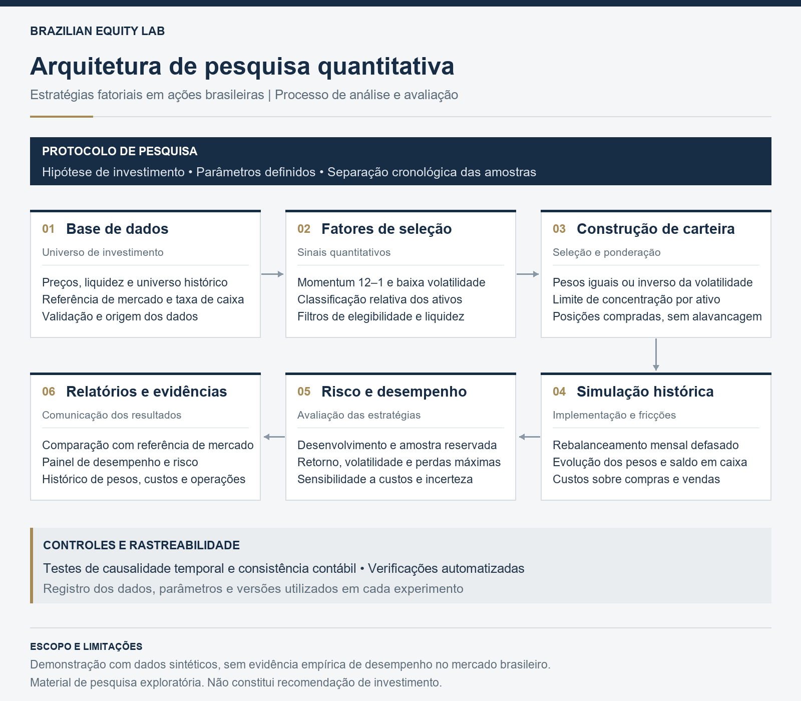

# Brazilian Equity Lab

**Factor investing · Portfolio construction · Investment research**

Framework de pesquisa quantitativa para investigar estratégias long-only de ações brasileiras com foco em **gestão e análise de investimentos**. Python modular, backtest auditável e comunicação de risco — sem promessas de alpha.


> **Transparência:** a demonstração padrão usa dados inteiramente sintéticos. Não representa ações reais, Ibovespa, CDI histórico ou evidência de performance no Brasil. O modo de dados reais exige uma base externa documentada e não vem com histórico licenciado embutido.

## A pergunta de investimento

**Uma combinação de momentum e baixa volatilidade melhora a relação risco-retorno de uma carteira de ações após custos?**

A hipótese é avaliada comparando o benchmark informado, universo elegível com pesos iguais, fatores isolados e combinação multifatorial. O objetivo não é escolher retrospectivamente o melhor gráfico: é entender seleção, ponderação, risco e fricções.

## O que está implementado

| Camada | Entrega |
|---|---|
| Dados | Contrato validado, membership histórico, controle de gaps e metadados de origem |
| Sinais | Momentum 12–1 e volatilidade de 126 sessões, ranks cross-section |
| Carteiras | Cinco estratégias, pesos iguais/inverso da volatilidade, cap via water-filling |
| Backtest | Rebalanceamento mensal, execução com defasagem, drift, caixa remunerado, custos por lado |
| Avaliação | Desenvolvimento/holdout cronológicos, janela comum, métricas absolutas e relativas |
| Robustez | Stress de custos e bootstrap circular em blocos do retorno ativo no holdout |
| Comunicação | Dashboard Streamlit, relatório HTML interativo offline e CSVs auditáveis |
| Engenharia | CLI, testes de causalidade temporal e contabilidade, lint, formatação e CI |
| Proveniência | Hash dos dados, parâmetros, versões, commit e estado do working tree |

### Carteiras

- `equal_universe`: todos os elegíveis, pesos iguais; controle para separar efeito da seleção.
- `momentum`: melhores ranks de momentum, pesos iguais.
- `low_volatility`: melhores ranks de baixa volatilidade, pesos iguais.
- `multifactor`: média dos ranks dos dois fatores, pesos iguais.
- `multifactor_inverse_vol`: mesma seleção, pesos proporcionais ao inverso da volatilidade, com cap.

**Inverso da volatilidade não é equal risk contribution.** O benchmark é externo ao motor e deve ser apropriado ao mandato.

## Executar em poucos minutos

### Windows / PowerShell

```powershell
py -3.13 -m venv .venv
.\.venv\Scripts\Activate.ps1
python -m pip install -e ".[dev,app]"
equity-lab demo
python -m streamlit run app/dashboard.py
```

Se a política do PowerShell impedir ativação, use os executáveis diretamente:

```powershell
.\.venv\Scripts\python.exe -m equity_lab.cli demo
.\.venv\Scripts\python.exe -m streamlit run app/dashboard.py
```

### Linux / macOS

```bash
python3 -m venv .venv
source .venv/bin/activate
pip install -e '.[dev,app]'
equity-lab demo
python -m streamlit run app/dashboard.py
```

Abra `outputs/demo/report.html` no navegador para o relatório autocontido, sem precisar manter um servidor. O dashboard usa os artefatos gerados: não recalibra parâmetros no holdout.

### Dados reais

Prepare os CSVs e os metadados conforme o [contrato de dados](docs/data-contract.md):

```bash
equity-lab run --data data/raw/meu_dataset --holdout-start 2023-01-01 --output outputs/real
```

Não basta baixar as ações existentes hoje. Universo histórico, deslistagens, retorno total e disponibilidade temporal são condições da interpretação, não detalhes cosméticos.

### API Python

```python
from equity_lab.backtest import BacktestConfig
from equity_lab.data import synthetic_data
from equity_lab.research import ResearchConfig, run_research

run_research(
    data=synthetic_data(seed=42),
    output="outputs/custom",
    config=ResearchConfig(holdout_start="2023-01-01", min_volume=5_000_000),
    trading=BacktestConfig(selection=0.30, cap=0.15, commission_bps=5, slippage_bps=5),
)
```

## Metodologia em 60 segundos

1. Universo histórico filtrado por liquidez e disponibilidade de sinais.
2. No fechamento mensal, calcula `P[t-21] / P[t-252] - 1` e volatilidade histórica.
3. Seleciona os 30% melhores scores, respeitando o número mínimo para viabilizar o cap de 15%.
4. Executa no fechamento da sessão seguinte; a nova posição só rende a partir da posterior.
5. Pesos derivam entre rebalanceamentos; caixa recebe a taxa diária fornecida.
6. Cobra custos sobre compras **e** vendas: turnover é notional total negociado, sem dividir por dois.
7. Compara desenvolvimento e holdout, sem otimização automática; analisa custos e incerteza.

Leia o [protocolo completo](docs/methodology.md), incluindo convenções de custos e limitações. O modelo de custo usa aproximação de pequeno custo entre notional pré-custo e alvos pós-custo, não execução exata de ordens.

## Artefatos

```text
outputs/demo/
├── report.html                         # relatório offline com gráficos e métricas
├── manifest.json                       # dataset, fingerprint, parâmetros, versões e Git
├── returns.csv                         # retornos na janela comum
├── metrics.csv                         # development / holdout / full
├── bootstrap_holdout.csv               # IC descritivo da média ativa
├── cost_sensitivity_holdout.csv        # stress 0/10/25/50 bps por lado
├── regimes_ex_post.csv                 # análise explicativa, não sinal de alocação
├── <strategy>_daily.csv                # bruto, líquido, custos, caixa e HHI
├── <strategy>_weights.csv              # pesos após fechamento
└── <strategy>_trades.csv                # data do sinal, execução e mudanças de peso
```

Os diretórios `outputs/` e dados brutos não são versionados. O CI gera a demonstração e disponibiliza os artefatos por execução.

## Qualidade e testes

```bash
pytest
ruff check .
ruff format --check .
```

Os testes verificam: ausência de dependência de dados futuros, fórmula exata do momentum, ordem sinal/execução, drift, viabilidade dos pesos, identidade contábil dos custos, drawdown desde o patrimônio inicial, falha em retornos ausentes e determinismo do bootstrap. O CI roda em Python 3.11 e 3.13.

As faixas do `pyproject.toml` permitem instalação em diferentes plataformas; **não são um lockfile**. Cada experimento registra versões numéricas no manifest. Para reproduzir integralmente um ambiente publicado, capture também `python -m pip freeze > requirements-lock.txt`.

## Arquitetura do projeto




## Estrutura

```text
src/equity_lab/
├── data.py          # contratos, carga CSV e gerador sintético
├── signals.py       # fatores e elegibilidade
├── portfolio.py     # seleção e pesos com cap
├── backtest.py      # simulação e trilha de decisões
├── analytics.py     # performance, risco, bootstrap e regimes
├── research.py      # protocolo, artefatos e relatório
└── cli.py           # execução por linha de comando
app/dashboard.py
tests/
docs/
.github/workflows/ci.yml
```

## Limitações e próximos passos institucionais

- Dados sintéticos validam comportamento de software, **não uma tese investível**.
- Loader valida schema, não certifica que o fornecedor é point-in-time ou inclui deslistadas.
- Não há neutralização setorial, otimização de covariância, impacto de mercado, capacidade ou conexão com corretora.
- Cap vale no rebalanceamento; pode ser excedido por drift. Universo insuficiente leva a caixa.
- O holdout deixa de ser fora da amostra quando passa a orientar ajustes. Comparar estratégias introduz risco de seleção.
- Bootstrap não corrige múltiplos testes; alpha CAPM não possui teste de significância.
- Regimes são ex-post, não previsões. A demo tem taxa de caixa constante e calendário de dias úteis genérico.
- Dados reais e licença de redistribuição são uma etapa externa pendente. Não há resultado empírico B3 publicado neste repositório.

**Critério para a próxima entrega:** integrar base histórica auditada, congelar protocolo e publicar relatório de investimento com conclusões — positivas ou negativas — e análise de sensibilidade de parâmetros no desenvolvimento.

## Licença e aviso

Código sob licença [MIT](LICENSE). Licenças de dados de terceiros não estão incluídas. Material educacional e de pesquisa; não constitui recomendação, oferta ou garantia de retorno. Sem vínculo ou endosso de instituições financeiras.
